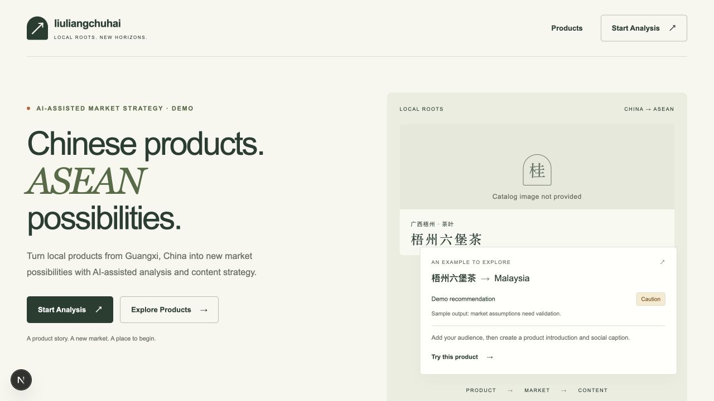
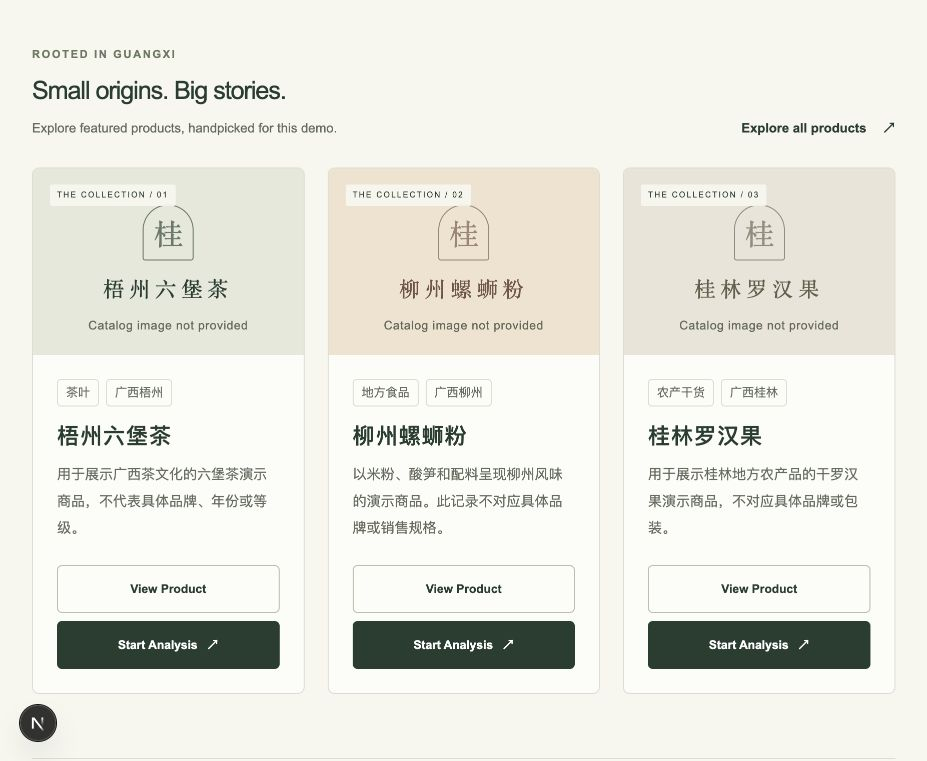
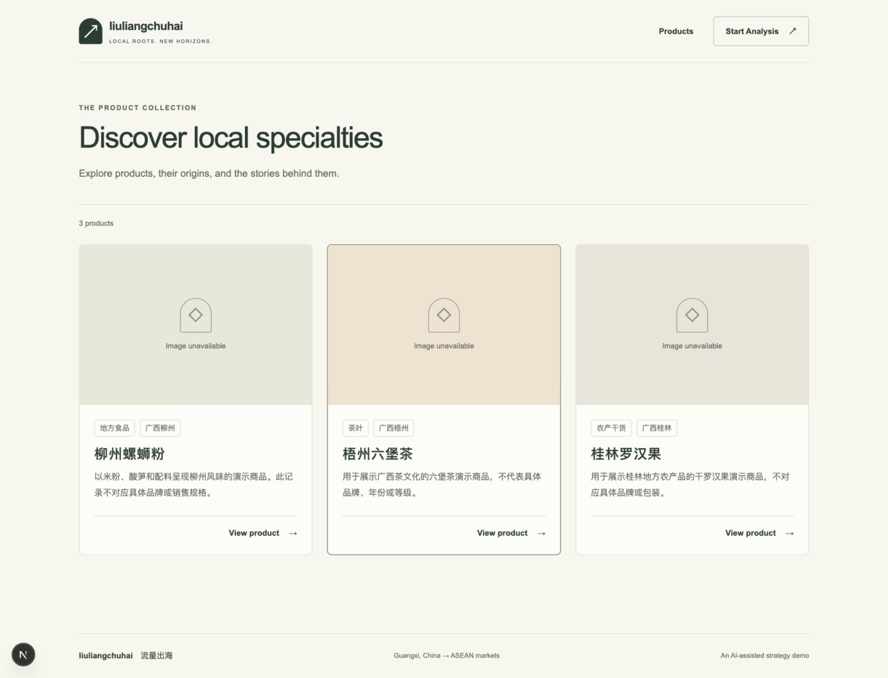
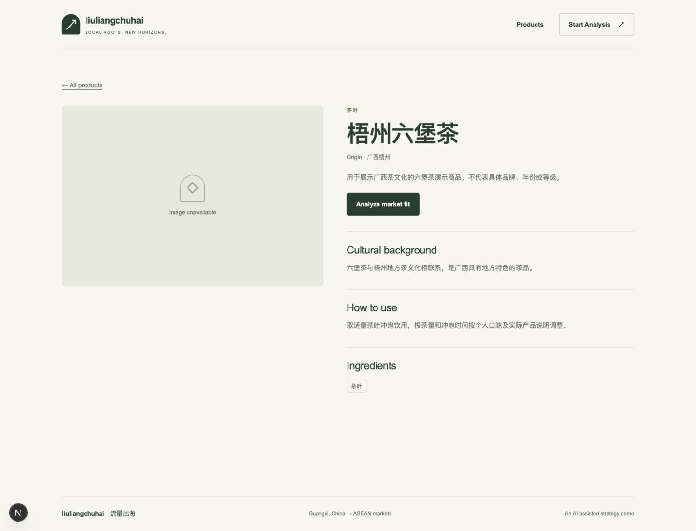
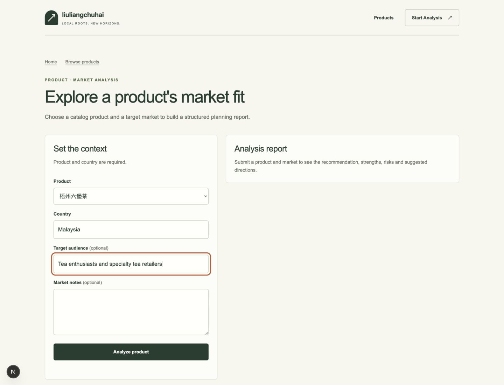
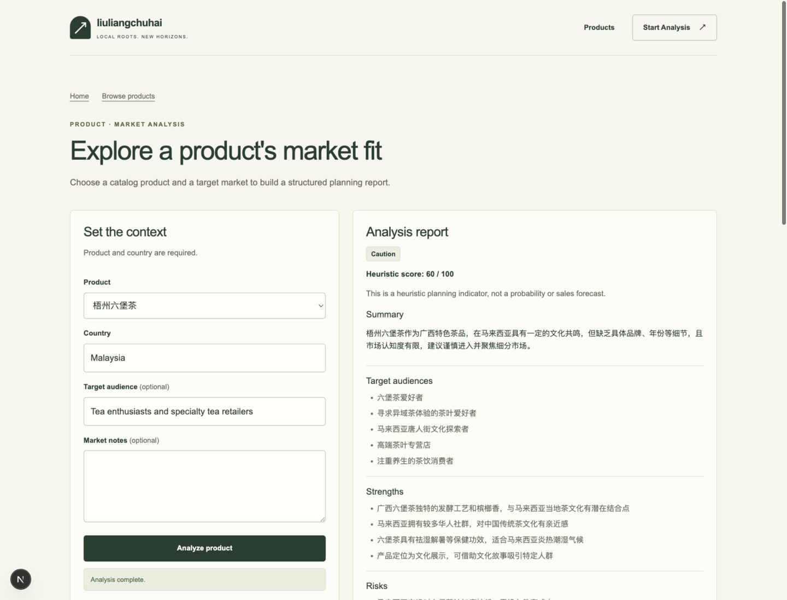
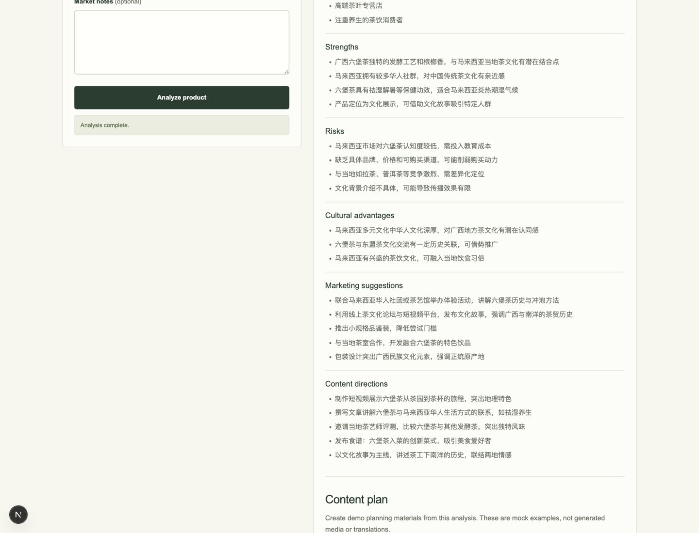
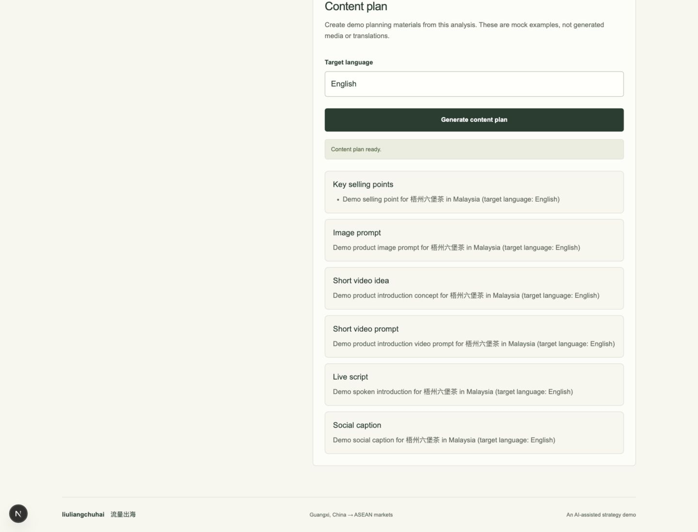

# liuliangchuhai · 流量出海

An AI-assisted market strategy demo for local products from Guangxi, China,
exploring ASEAN markets. Browse the Guangxi demo catalog—from Liuzhou luosifen
to Qinzhou Nixing pottery—then turn a market-fit analysis into a content plan.
Built with FastAPI and Next.js.

The default demo runs without API keys. DeepSeek can provide real market analysis
and localized content plans. Content plans are marketing copy and creative prompts,
not generated images or videos. The key-free mode keeps deterministic, explicitly
labeled mock examples.
Scores and AI claims are planning suggestions that need independent validation.

## Quick start

Prerequisites: Python 3.12+, uv, Node.js 22, and pnpm 10.33.0. Run from the repository root.

macOS/Linux:

```sh
make bootstrap
make dev
```

Windows or without Make:

```sh
uv run python scripts/dev.py bootstrap
uv run python scripts/dev.py dev
```

Bootstrap installs locked dependencies and creates `apps/api/.env` and
`apps/web/.env.local` from their examples only if they do not already exist.
The default LLM provider is `mock`; an existing local configuration is preserved.

Open [the demo](http://localhost:3000). The API runs on port 8000:
[API docs](http://localhost:8000/docs) · [provider health](http://localhost:8000/health).
Stop both development servers with Ctrl+C.

## Running with DeepSeek

After bootstrap, edit your local `apps/api/.env`:

```dotenv
LIULIANGCHUHAI_LLM_PROVIDER=deepseek
LIULIANGCHUHAI_DEEPSEEK_API_KEY=<your-key>

# Optional: these are the current defaults
LIULIANGCHUHAI_DEEPSEEK_MODEL=deepseek-v4-flash
LIULIANGCHUHAI_DEEPSEEK_TIMEOUT_SECONDS=20
```

Use your own DeepSeek API key, then restart `make dev` (or the Python equivalent).
Check `/health`: `providers.llm.provider` should be `deepseek` and `available`
should be `true`. This selector enables DeepSeek for both market analysis and Content
Plan, using the same key, model and timeout. Follow the demo flow to run both; health
alone only checks provider availability. Content Plan uses the canonical product,
market/language and the existing analysis's audience, risks and recommendation in one
bounded request, without rerunning analysis or falling back to mock on failure.

Its instructions coordinate the six fields around a localized strategy. Invalid JSON,
placeholders, too-short sections and basic English language-check failures use the existing
content-plan error. These checks do not prove factual accuracy or marketing effectiveness;
review the assets before use. If a request times out, increase the local timeout and restart.

Switch `LIULIANGCHUHAI_LLM_PROVIDER` back to `mock` and restart for the key-free demo.
Ordinary development and `make check` need no external credentials. Never commit
`.env` files or API keys; keep the key in backend configuration only.

The product assistant has an independent selector: set
`LIULIANGCHUHAI_ASSISTANT_PROVIDER=deepseek` in the same backend `.env` to enable
natural replies at `POST /assistant/chat`. It reuses the DeepSeek key, model, and
timeout above; either DeepSeek capability requires the key. The assistant defaults
to `mock`, independently of market analysis. Each reply uses one bounded provider
request, with no retries or silent mock fallback. Product context remains canonical
and optional; requests contain only the current message and optional `product_id`.

## Demo flow

1. Open `/` and choose **Explore Products**.
2. On `/products`, open a product such as **梧州六堡茶**.
3. On `/products/wuzhou-liubao-tea`, choose **Analyze market fit**.
4. On `/analysis`, confirm the preselected product, enter **Malaysia**, optionally
   add an audience or market notes, and choose **Analyze product**.
5. Read the recommendation, heuristic score, summary, audiences, strengths,
   risks, cultural advantages, marketing suggestions, and content directions.
6. Scroll to **Content plan**, enter a target language, and choose
   **Generate content plan**. The result includes selling points, an image prompt,
   a short video idea and prompt, a live script, and a social caption.

Content planning is part of `/analysis`; there is no separate `/content-plan`
page. Opening `/analysis` directly starts with an empty product selector.

## Screenshots

Captured from the running local demo. The catalog currently has no product photos
or purchase links, so its image placeholders and analysis actions are shown as-is.
The landing-page example is sample output; the DeepSeek report below is a real run.

### Landing page and featured products




### Product catalog



### Product detail



### Analysis input



### Real DeepSeek analysis

This local run used DeepSeek for Wuzhou Liubao tea in Malaysia and returned
**Caution · 60/100**. The local health endpoint reported `deepseek` available;
the analysis request completed successfully. Output varies between runs.




### Content plan result

This earlier screenshot shows the key-free mock content planner. With DeepSeek
selected, the same six sections now contain localized marketing assets.



## Key visual

The content plan produces an image prompt. The analysis page can turn that prompt
into one finished still; two providers sit behind the same port.

| `LIULIANGCHUHAI_IMAGE_PROVIDER` | What it produces | Needs |
|---|---|---|
| `drawn` (default) | A designed 1080×1920 backdrop from the site's own palette, titled with the first selling point | Nothing — runs on any laptop |
| `openai` | A generated photograph from any endpoint that speaks `/images/generations` | A key, and optionally a relay base URL |
| `dashscope` | A generated photograph from Alibaba Cloud (`wanx2.1-t2i-turbo`) | A Bailian key — the same one the video providers use |
| `mock` | Fixed placeholder URL | Nothing |

`drawn` is a poster, not a product photograph — the panel says so under the
image. To get real photographs, point the `openai` provider at OpenAI or at a
relay that speaks the same API:

```dotenv
LIULIANGCHUHAI_IMAGE_PROVIDER=openai
LIULIANGCHUHAI_IMAGE_API_KEY=sk-...
LIULIANGCHUHAI_IMAGE_BASE_URL=https://your-relay.example/v1   # omit for OpenAI
LIULIANGCHUHAI_IMAGE_MODEL=gpt-image-1
LIULIANGCHUHAI_IMAGE_SIZE=1024x1536
```

Both `b64_json` and `url` responses are accepted, and the bytes are always copied
into local media so an expiring signed URL cannot break the page later.

If you already have a Bailian key for the video providers, reuse it instead of
opening a second vendor:

```dotenv
LIULIANGCHUHAI_IMAGE_PROVIDER=dashscope
LIULIANGCHUHAI_DASHSCOPE_API_KEY=sk-...
LIULIANGCHUHAI_DASHSCOPE_IMAGE_MODEL=wanx2.1-t2i-turbo
LIULIANGCHUHAI_DASHSCOPE_IMAGE_SIZE=720*1280
```

## Digital-human video

The analysis page turns a finished live script into a presenter video. Three
renderers are available behind one port; the default needs no account at all.

| `LIULIANGCHUHAI_DIGITAL_HUMAN_PROVIDER` | What it produces | Needs |
|---|---|---|
| `local` (default) | 1080×1920 clip: neural narration, burned captions, a drawn Southeast Asian scene cut into three cross-faded shots | Nothing — runs on any laptop |
| `wan_s2v` | Talking portrait from a single still: `wan2.2-s2v` animates a photo with the narration | A personal Alibaba Cloud key and one photo |
| `dashscope` | Photoreal talking head: your own source clip re-driven with the narration | A personal Alibaba Cloud account and one recorded clip |
| `heygen` | Photoreal talking head from HeyGen avatars | HeyGen key, avatar and voice ids |
| `mock` | Fixed placeholder URL | Nothing |

### A photo instead of a recording (`wan_s2v`)

`videoretalk` needs a video of you; `wan2.2-s2v` needs only a still picture,
which is the difference between "record yourself" and "find a photo".

```dotenv
LIULIANGCHUHAI_DIGITAL_HUMAN_PROVIDER=wan_s2v
LIULIANGCHUHAI_DASHSCOPE_API_KEY=sk-...
LIULIANGCHUHAI_DASHSCOPE_AVATAR_PORTRAIT=apps/api/media/presenter.png  # or an https URL
LIULIANGCHUHAI_DASHSCOPE_S2V_RESOLUTION=720P                            # or 480P
```

The model caps the audio at 20 seconds and 15 MB, so a longer script is rejected
with a clear error rather than silently truncated. Both the narration and a
local portrait are pushed through DashScope's own upload endpoint first, so
nothing needs a public server.

### Replacing the drawn art

The default frame is drawn in code so the demo needs no image assets and no
stock-photo licence. It carries no photo of its own: a face has to be one you
have the right to use. Supply a portrait and it is cropped into a circular
medallion on the sun, with a paper halo and a lacquer ring:

```sh
# either drop a file in the ignored media directory…
apps/api/media/presenter.png        # .jpg, .jpeg and .webp also work
# …or point at one anywhere on disk
LIULIANGCHUHAI_VIDEO_PRESENTER=/path/to/portrait.jpg
```

The square crop is biased to the upper part of the image, because faces sit
above the centre line in almost every portrait. Two further overrides:

```dotenv
LIULIANGCHUHAI_VIDEO_BACKGROUND=/path/to/scene.jpg    # full-bleed photo
LIULIANGCHUHAI_VIDEO_FONT=/path/to/Unicode.ttf        # font for every drawn glyph
```

A swapped file changes the render fingerprint, so the next run re-renders instead
of serving the cached clip. Captions are burned from an ASS file that states its
own 1080×1920 resolution, which keeps their point size independent of the player.

### The virtual-streamer body shot

The middle shot is a drawn chibi presenter, animated from the narration itself:
the mouth opens on loudness and closes in the pauses, the eyes blink, and the
figure sways. No model file, no GPU and no recording — a new script produces a
new moving presenter on its own.

To use a real avatar instead, record once and reuse it: export a vertical clip
from VTube Studio, VSeeFace or VMagicMirror and drop it in.

```sh
apps/api/media/avatar.mp4              # .mov, .webm and .m4v also work
LIULIANGCHUHAI_AVATAR_CLIP=/path/to/clip.mp4   # or point anywhere on disk
```

Either way the opening and end cards are still drawn, the body shot is looped to
the narration's length, cropped to 1080×1920 and captioned on top. A supplied
clip's mouth movement belongs to whatever was recorded, so treat it as a
presenter cutaway rather than lip sync of the generated script.

### Alibaba Cloud Bailian (`videoretalk`)

This is the option a solo developer in mainland China can open without a company
entity: personal real-name verification, a self-serve API key, plain HTTPS and no
GPU. The trade-off is that you record one short clip of yourself and reuse it.

```dotenv
LIULIANGCHUHAI_DIGITAL_HUMAN_PROVIDER=dashscope
LIULIANGCHUHAI_DASHSCOPE_API_KEY=sk-...
LIULIANGCHUHAI_DASHSCOPE_SOURCE_VIDEO_URL=https://<reachable>/my-clip.mp4
```

The adapter speaks the script with Edge TTS, uploads the audio through
DashScope's own upload endpoint (so no public server is needed), submits the
render, then copies the finished MP4 into `apps/api/media` before its 24-hour
signed URL expires. `GET /health` reports `available: true` once the key is
accepted.

Pricing and quota are set by Alibaba Cloud and change; see their console.

### Embedding on another site

`/embed` is a chrome-free variant of the analysis page that any site can frame:

```html
<iframe src="https://<this-demo>/embed?product_id=wuzhou-liubao-tea&lang=en"
  style="border:0;width:100%" height="900" loading="lazy" title="liuliangchuhai"></iframe>
```

After a report is generated the analysis page shows the exact snippet, generated
from the origin the visitor actually reached the page through. The embed reports
its own height with `postMessage` so the host page can size the frame. Framing
is allowed for `/embed` only; every other route sends `frame-ancestors 'none'`.

## Development checks

Run `make check`, or `uv run python scripts/dev.py check` without Make.
See [contributing](CONTRIBUTING.md), [architecture](docs/ARCHITECTURE.md), and
[repository guidance](AGENTS.md) for development details.
